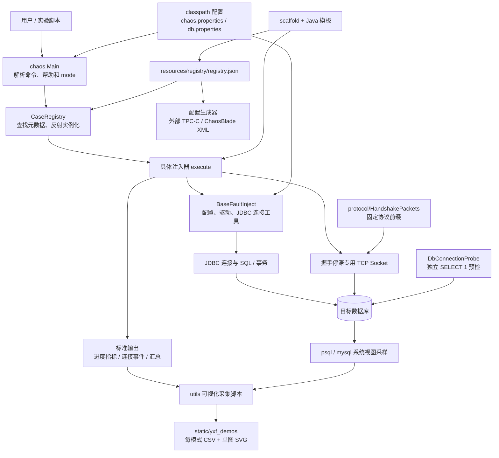

# DBChaos 系统架构

更新日期：2026-10-31。本文说明运行架构；目录导览见 [DBChaos 架构说明](DBChaos_架构说明.md)，新增五个连接类 Case 的实验说明见 [杨小飞新增故障情况](杨小飞新增故障情况.MD)。

## 1. 当前实现范围

DBChaos 是命令行故障注入工具。Java 注入器通过 JDBC 操作连接、SQL 和事务，或通过原始 TCP Socket 构造握手停滞；Python 工具负责配置生成、真实运行数据采集与绘图。项目没有统一的应用连接池或自动重连层。

当前 `resources/registry/registry.json` 定义 **9 个子系统、18 条 Case 注册记录，对应 17 个不同的 Case 名和 17 个注入器类**。`stack_overflow` 同时注册于 `sql` 和 `exec`，共享一个实现。

| 子系统 | 当前 Case |
| --- | --- |
| `session` 连接与会话管理 | `max_connection`、`idle_session_buildup`、`idle_transaction_buildup`、`connection_auth_failure`、`session_forced_termination`、`connection_handshake_stall` |
| `sql` SQL 编译与优化 | `plan_flip`、`stack_overflow` |
| `exec` 执行引擎 | `stack_overflow`、`read_amp_trap` |
| `txn` 事务与并发控制 | `uncommitted_txn`、`duplicate_txn`、`deadlock_storm`、`max_prepared` |
| `storage` 存储引擎 | `mvcc_bloat` |
| `buffer` 缓冲管理 | `memory_pressure` |
| `log` 日志、检查点与崩溃恢复 | `massive_rollback` |
| `task` 后台维护与系统任务 | 尚无 Case |
| `quota` 资源治理与系统配额 | `test_case`，用于扩展链路验证的示例入口 |

有实际故障实现的子系统为 7 个；另有 `quota` 示例入口，不能将其视为完整的资源治理故障实现。CLI 接受 PostgreSQL、openGauss、MySQL 等数据库类型，但具体 SQL、权限和协议支持由各注入器决定，不能据此推断所有 Case 在所有数据库上完全兼容。

## 2. 总体架构



两类采集输入由不同脚本选用，并非每个脚本都会查询数据库；详见第 5 节。连接预检也是独立工具，`Main` 不会在每次注入前自动执行 `SELECT 1`。

## 3. CLI、注册表与配置

### 调用链路

```text
java -cp "<配置目录>:<匹配的驱动 jar>:<DBChaos jar>" chaos.Main
  [--db <type>] <subsystem> <case> [options]
```

上面的 classpath 分隔符适用于 Linux；Windows 使用 `;`。也支持 `java -jar`，但需要覆盖配置或优先选择外置驱动时，应使用 `-cp ... chaos.Main`。

1. `Main` 从 classpath 读取 CLI 元数据和默认数据库类型；`--db` 优先于 `db.properties` 中的 `type`，两者均未提供时默认 `opengauss`。
2. 校验子系统与 Case 归属；对配置了 `allowedModes` 的 Case 校验模式，并按 `defaultMode` 补默认模式。具体数量、时长等参数仍由注入器校验。
3. 解析 `-url`、`-user`、`-password` 等覆盖参数。
4. `CaseRegistry` 从 `/registry/registry.json` 加载元数据，通过 `injectorClass` 和 `String dbType` 构造函数创建实例。
5. 实例构造时 `BaseFaultInject` 读取配置并加载驱动；随后执行帮助或 `execute`。因此具体 Case 的帮助入口也会经过基类初始化。
6. 注入器负责执行、结果统计和资源清理。当前 `Main` 对执行异常主要打印“执行异常”，不会统一以非零退出码表示失败；自动化脚本还应检查实际指标和输出。

### 配置的两个优先级

**先决定读哪份文件：**基类通过 classpath 读取 `/db.properties`，不会合并多份同名文件。`resources` 是 Maven 打包资源目录；部署时可自行建立 `config/db.properties` 并把 `config` 放在 jar 之前。当前本地项目没有 `config` 目录，它是部署约定，而非 Java 内置固定路径。

**再决定取文件中的哪个值：**每个连接字段单独按以下顺序选择：

```text
命令行覆盖值 → 数据库专属字段 → 通用 url / user / password
```

| 数据库选择 | 配置字段前缀查找顺序 |
| --- | --- |
| `postgresql` | `postgresql.*` → 通用字段 |
| `opengauss` | `opengauss.*` → `og.*` → `postgresql.*` → 通用字段 |
| `mysql` | `mysql.*` → 通用字段 |

基类内部将 PostgreSQL 与 openGauss 归为同一 SQL 方言分支，但仍保留原始 `dbType` 供驱动选择和特定 Case 分支使用。**这不会使 openGauss 请求转发到 PostgreSQL**：实际目标由选中的 URL 决定。

PostgreSQL 驱动类为 `org.postgresql.Driver`，MySQL 为 `com.mysql.cj.jdbc.Driver`；openGauss 优先尝试 `org.opengauss.Driver`，找不到时尝试 `org.postgresql.Driver`。部分驱动共享类名，部署时应把匹配的驱动 jar 放在 DBChaos fat jar 前，避免加载到不匹配的实现。推荐命令使用完整名称 `postgresql`、`opengauss`、`mysql`。

### 注册表职责

`caseKey`、`subsystem`、`title`、`description` 和 `injectorClass` 描述运行入口；`defaultMode` / `allowedModes` 支持 CLI 模式约束；`generatorProfiles` 为外部配置生成器提供分模式参数和编排信息。注册表不是全部参数的统一 schema，数值范围、默认数量和数据库细节仍以注入器源码为准。

## 4. 新增连接类故障的实现边界

`session` 在原 `MaxConnectionInject` 的 3 个模式外，新增 5 个 Case、12 个模式；合计 6 个 Case、15 个模式。原 `max_connection` 保留 `conn_storm`、`conn_exhaustion`、`thread_saturation`。

| 新增 Case / 实现类 | 模式 | 运行与清理方式 |
| --- | --- | --- |
| `idle_session_buildup` / `IdleSessionBuildupInject` | `fixed`、`ramp`、`random_hold` | 建立自动提交连接后保持空闲；按模式统一保持、逐步建立或随机释放；最终关闭剩余连接。 |
| `idle_transaction_buildup` / `IdleTransactionBuildupInject` | `fixed`、`ramp`、`random_hold` | JDBC 设置 `REPEATABLE READ`、只读和关闭自动提交，读取实验表一行后保持事务打开；释放时调用 `rollback()` 再关闭连接。 |
| `connection_auth_failure` / `ConnectionAuthFailureInject` | `serial`、`burst` | 每次运行生成虚构用户名，逐次或有限并发尝试连接；区分 SQLState `28` 类认证拒绝、其他错误和意外成功，关闭意外建立的连接。 |
| `session_forced_termination` / `SessionForcedTerminationInject` | `serial`、`burst` | 建立自己的目标会话并取得 ID；独立控制连接逐个或并发终止它们，检查存活情况，最后关闭剩余目标连接；不实现应用重连。 |
| `connection_handshake_stall` / `ConnectionHandshakeStallInject` | `silent`、`partial` | 使用原始 Socket 在协议初始化阶段停滞；分别统计对端 EOF、传输错误、观察到期关闭和准备失败；结束时清理 Socket 和线程池。 |

`random_hold` 的两个 Case 都先建立一批连接/事务，再为它们安排随机释放时间，**不会在释放后补建**。`ramp` 才是在注入窗口内逐步创建。`fixed` / `random_hold` 的保持窗口开始前还有建立阶段，不能把 `duration` 直接等同于进程总运行时间。

空闲事务使用 JDBC 事务控制，不直接拼接 `BEGIN` / `COMMIT`。实验表须已有数据，MySQL/MariaDB 应使用 InnoDB；只读不代表完全无锁，读取仍可能保留表级读锁、元数据锁或快照。

强制终止只针对本次建立并记录的目标会话。PostgreSQL 调用 `pg_terminate_backend(integer)`，openGauss 调用 `pg_terminate_backend(bigint)`，MySQL/MariaDB 使用 `KILL CONNECTION`。控制账号默认复用配置账号，也可单独覆盖，权限要求取决于目标数据库和会话所有者。

### 握手协议模块

`src/chaos/protocol/HandshakePackets.java` 从完整启动/响应包构造固定前缀；第一版不开放任意截断位置：

| 数据库 | `partial` 停滞位置 |
| --- | --- |
| PostgreSQL | 协议 3.0 启动包的前 12 字节 |
| openGauss 7.0.0-RC2 | 协议 3.51 启动包的前 12 字节 |
| MySQL/MariaDB | 读取完整服务端问候后，发送客户端响应的前 8 字节 |

`silent` 建立 TCP 后不发送数据库协议数据；两个模式均不完成认证、不发送密码、不执行 SQL。第一版仅支持单地址、无查询参数的非 TLS 直连 URL，可用 `-url` 覆盖。即使不使用 JDBC 建连，该注入器仍继承基类的配置和驱动初始化。

## 5. 真实运行可视化

脚本会启动真实注入，不是离线生成模拟数据。每个模式输出一个 CSV 和一个仅含一张图的 SVG，覆盖注入前、注入中与注入后；所需输出目录由脚本自动创建。

| 入口脚本（`utils/`） | 数据来源与模式 | 默认输出目录（`static/yxf_demos/` 下） |
| --- | --- | --- |
| `plot_idle_transaction_buildup.py` | 启动 Java 注入，同时通过 `psql` 或 `mysql` 查询事务视图；支持 PostgreSQL、MySQL，默认遍历 3 个模式 | `IdleTransactionBuildup/` |
| `plot_connection_auth_failure.py` | 解析注入器 `DBCHAOS_AUTH_METRIC` 指标，自动运行 `serial` / `burst` | `ConnectionAuthFailure/` |
| `plot_session_forced_termination.py` | 解析 `DBCHAOS_SESSION_METRIC` 指标，自动运行 `serial` / `burst` | `SessionForcedTermination/` |
| `plot_connection_handshake_stall.py` | 解析逐连接停滞事件、关闭结果和汇总，自动运行 `silent` / `partial`；须指定 `--db` 和 `--classpath` | `ConnectionHandshakeStall/` |

认证失败和会话终止脚本共用 `plot_case_visualization.py` 的子进程采集、事件时间处理、CSV 和 SVG 渲染；握手停滞脚本复用其中的 SVG 渲染函数，并自行解析连接事件。

这些数据有不同含义：认证拒绝累计数表示已完成的拒绝次数；强制终止的 `active` 是注入器按“已建立数－成功终止数”计算的目标会话数，清理事件置零；握手的活动停滞数来自本次 Socket 事件。它们均不是整个数据库的实时会话总量。事件采集脚本在进程结束后保留最终计数，不会持续查询数据库来证明服务器已恢复；CPU、内存也不在上述脚本的采集范围内。

空闲事务脚本则在等待窗口持续查询数据库视图，查询失败会记录 `sample_error`，不能将其当作事务数为零。握手脚本中的 EOF 仅说明对端关闭连接，关闭原因仍须结合数据库日志判断。

项目还保留 `plot_injection_timeline.py`（PostgreSQL 上的锁等待、连接风暴、回滚过程）、`plot_tpcc_tpm.py`（BenchBase 结果分析）和 `convert_cases.py`（旧配置迁移）。目前没有空闲会话积压的专用可视化入口。

## 6. 构建、外围工具与扩展

Maven 使用 `src` 作为源码目录、`resources` 作为资源目录，`pom.xml` 声明 Java 8 source/target 和 3 种数据库的 JDBC 依赖，通过 Assembly 生成含依赖 jar。`jar.name` 默认是 `resilienceChaos-1.0`；构建脚本和部署示例常用 `DBChaos-0.0.1`，可通过属性覆盖：

```powershell
mvn clean package "-Djar.name=DBChaos-0.0.1" "-Dmaven.compiler.source=1.8" "-Dmaven.compiler.target=1.8" -DskipTests
```

`build_for_linux.sh` 包装 Maven；`build_for_win.ps1` 使用本地 `javac` / `jar` 编译打包，当前未显式限定字节码版本。使用高版本 JDK 运行该 PowerShell 脚本时，不能据 `pom.xml` 推断其产物兼容 Java 8。仓库根目录和 `target` 的现成 jar 都是构建产物，更新源码后须重新打包。

新增 Case 的维护链路：

1. 在 `src/chaos/inject` 实现继承 `BaseFaultInject` 的类，并提供 `String dbType` 构造函数、帮助、参数校验、统计和资源清理。
2. 在 `resources/registry/registry.json` 增加对应入口与模式元数据；需要外部编排时为各模式补 `generatorProfiles`。脚手架位于 `scripts/scaffold`，模板位于 `templates`。
3. 补充 `docs` 中的场景、参数和实验说明；需要可视化时明确指标来自数据库视图还是注入器事件，脚本置于 `utils`，结果置于 `static/yxf_demos`。
4. 重新构建并做适当本地检查；实际服务器注入与数据库验证由用户执行。

`scripts/config_generator/generate_configs.py` 消费同一注册表生成外部 TPC-C / ChaosBlade XML，不会直接执行注入。`scripts/probe` 提供独立连接和环境检查。当前目录树没有旧架构文档中的 `demo/` 或 `yxf_files/`；`preflight_check.sh --with-demo` 仍引用外部 BenchmarkSQL 及缺失的 Demo 文件，因此这条可选分支不是当前开箱可用的编排流程。

项目操作边界遵循根目录 `AGENTS.md`：不执行 Git/GitHub 操作，不代用户登录服务器或连接数据库，不将真实凭据写入仓库。
