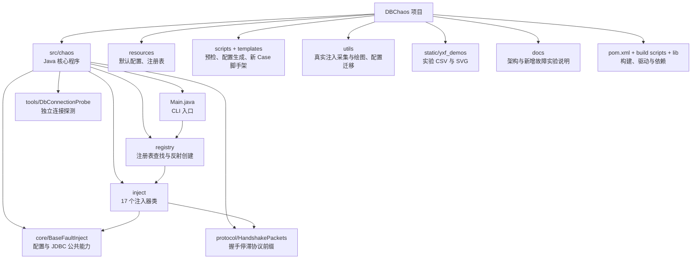
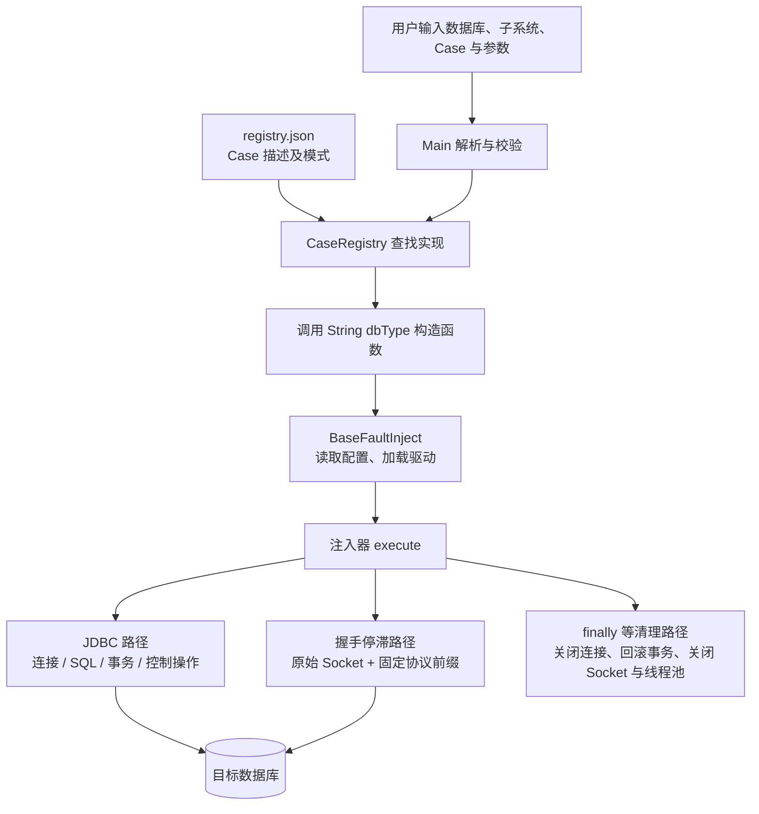
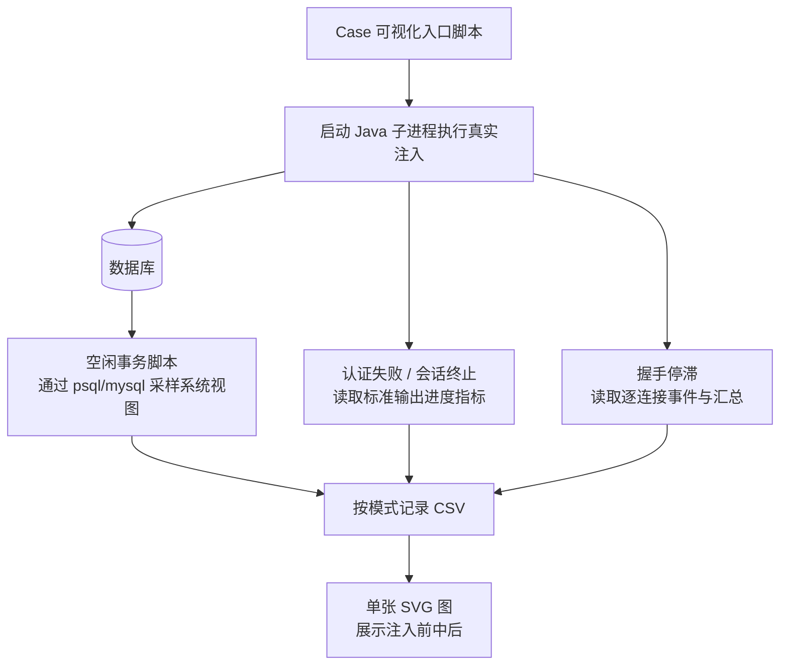

# DBChaos 架构说明

更新日期：2026-10-31。本文件面向项目接手和新增 Case 开发，按“目录 → 核心关系 → 连接类扩展 → 可视化 → 阅读顺序”介绍当前项目。运行机制的详细说明见 [系统架构](ARCHITECTURE.md)，五个新增故障的场景、参数与实验命令见 [杨小飞新增故障情况](杨小飞新增故障情况.MD)。

## 1. 先认识项目的组成



当前共有 9 个子系统、18 条 Case 注册记录；由于 `stack_overflow` 在两个子系统复用，实际是 17 个不同 Case 名和 17 个注入器类。其中 `test_case` 是扩展验证示例，`task` 尚无 Case。连接与会话管理 `session` 已有 6 个 Case：原有最大连接数，加上新增的空闲会话积压、空闲事务积压、连接认证失败、会话强制终止、连接握手停滞。

## 2. 当前文件树

下列列出接手项目时最常用的真实路径，构建目录与实验目录只展示职责，不展开全部产物。旧版文档中的 `yxf_files/`、`demo/` 当前均不存在。

```text
DBChaos/
├── AGENTS.md                             项目操作约束
├── README.md                             项目入口说明
├── pom.xml                               Maven：Java 8 目标、驱动依赖、fat jar
├── build_for_linux.sh                    Maven 构建包装脚本
├── build_for_win.ps1                     本地 javac/jar 构建、帮助和预检入口
├── DBChaos-0.0.1.jar                      已有构建产物，不能代表最新源码
├── src/chaos/
│   ├── Main.java                         CLI 解析、帮助、参数覆盖、调度
│   ├── core/
│   │   └── BaseFaultInject.java          配置选择、驱动加载、JDBC 连接工具
│   ├── inject/
│   │   ├── MaxConnectionInject.java      原有最大连接数 Case，含 3 个模式
│   │   ├── IdleSessionBuildupInject.java 新增：空闲会话积压
│   │   ├── IdleTransactionBuildupInject.java 新增：空闲事务积压
│   │   ├── ConnectionAuthFailureInject.java 新增：连接认证失败
│   │   ├── SessionForcedTerminationInject.java 新增：会话强制终止
│   │   ├── ConnectionHandshakeStallInject.java 新增：连接握手停滞
│   │   ├── PlanFlipInject.java           计划扰动
│   │   ├── StackOverflowInject.java      深层 SQL 等压力，sql/exec 共用
│   │   ├── UncommittedTxnInject.java     未提交事务持锁
│   │   ├── DuplicateTxnInject.java       热点更新与重复插入冲突
│   │   ├── DeadlockStormInject.java      死锁压力
│   │   ├── MaxPreparedInject.java        Prepared/XA 事务积压
│   │   ├── MvccBloatInject.java          长快照与版本膨胀
│   │   ├── ReadAmpTrapInject.java        扫描与读取放大
│   │   ├── MemoryPressureFault.java      大对象写入压力
│   │   ├── MassiveRollbackInject.java    高频事务回滚
│   │   └── TestCaseInject.java           扩展验证示例
│   ├── protocol/
│   │   └── HandshakePackets.java         PostgreSQL/openGauss/MySQL 固定握手前缀
│   ├── registry/
│   │   ├── CaseRegistry.java             JSON 加载、查找和反射实例化
│   │   ├── CaseDescriptor.java           Case 元数据模型
│   │   ├── SubsystemDescriptor.java      子系统元数据模型
│   │   └── SimpleJsonParser.java         内置 JSON 解析器
│   └── tools/
│       └── DbConnectionProbe.java        独立 JDBC SELECT 1 探测
├── resources/
│   ├── chaos.properties                  CLI 元数据
│   ├── db.properties                     默认数据库类型、连接配置
│   └── registry/registry.json            子系统、Case、模式与 generatorProfiles
├── scripts/
│   ├── README.md
│   ├── probe/
│   │   ├── check_db_connection.ps1        Windows 连接探测
│   │   ├── check_db_connection.sh         Linux/macOS 连接探测
│   │   └── preflight_check.sh            环境预检；可选 Demo 分支需额外文件
│   ├── config_generator/
│   │   ├── generate_configs.py           注册表转外部 TPC-C/ChaosBlade XML
│   │   └── README.md
│   └── scaffold/
│       ├── new_case.py                   生成注入器骨架与注册信息
│       ├── new_case.ps1                  Windows 包装入口
│       ├── new_case.sh                   Linux/macOS 包装入口
│       └── README.md
├── templates/
│   └── CaseInject.java.template          注入器 Java 模板
├── utils/
│   ├── plot_idle_transaction_buildup.py   事务视图采样；自动跑 3 个模式
│   ├── plot_connection_auth_failure.py    认证失败事件采集；自动跑 2 个模式
│   ├── plot_session_forced_termination.py 会话终止事件采集；自动跑 2 个模式
│   ├── plot_connection_handshake_stall.py 握手事件采集；自动跑 2 个模式
│   ├── plot_case_visualization.py         共享进度采集与 CSV/SVG 渲染
│   ├── plot_injection_timeline.py         PostgreSQL 锁/连接风暴/回滚采样
│   ├── plot_tpcc_tpm.py                   BenchBase 结果 TPM 曲线
│   ├── convert_cases.py                   旧版 XML 配置转换
│   └── readme                            占位说明
├── static/
│   ├── demo/                             原有演示 SVG
│   └── yxf_demos/                        实验 CSV、SVG；脚本自动创建目标目录
│       ├── IdleTransactionBuildup/
│       ├── ConnectionAuthFailure/
│       ├── SessionForcedTermination/
│       ├── ConnectionHandshakeStall/
│       ├── MaxConnection/
│       ├── DeadlockStorm/
│       └── MassiveRollback/
├── lib/                                  本地依赖 jar
│   ├── postgresql-42.7.2.jar
│   ├── opengauss-jdbc-7.0.0-RC2.jar
│   ├── mysql-connector-j-8.0.33.jar
│   ├── checker-qual-3.42.0.jar
│   └── protobuf-java-3.21.9.jar
├── docs/
│   ├── ARCHITECTURE.md                    系统架构与运行机制
│   ├── DBChaos_架构说明.md                本文件：目录导览与源码入口
│   └── 杨小飞新增故障情况.MD              五个新增 Case 的模式和实验说明
└── target/                               构建生成目录，内容随构建方式变化
```

`config/` 当前不在本地目录树中。服务器部署时可自行建立它，将本地配置文件放入其中，并通过 classpath 优先读取。凭据由用户在自己的本地配置中维护，不写进文档或提交到仓库。

## 3. 一条注入命令如何运行



`Main` 管“选择哪个 Case”；`CaseRegistry` 管“找到哪个实现类”；`BaseFaultInject` 管“读取哪些连接字段、加载哪个驱动”；各注入器管“如何产生故障、统计和清理”。主程序不会自动执行预检工具，也不会自动连接业务应用或建立应用连接池。

配置先从 classpath 找到一份 `db.properties`，再逐字段按“命令行覆盖 → 数据库专属字段 → 通用字段”选值。openGauss 还可回退至 `og.*` 和 `postgresql.*`，所以配置遗漏时要留意目标地址；内部共用部分 PostgreSQL 方言并不意味着连接了另一种数据库。

部署到 Linux 的调用示例：

```bash
java -cp "config:lib/postgresql-42.7.2.jar:target/DBChaos-0.0.1.jar" chaos.Main --db postgresql session idle_session_buildup -mode fixed -count 20 -duration 60000
```

`config` 和对应驱动在 jar 之前；Windows classpath 分隔符改用 `;`。切换数据库时，同时检查数据库类型、URL、凭据和驱动，不能只替换驱动文件。

## 4. 新增五个 Case 应该从哪里读

| Case | 模式 | 核心实现关注点 |
| --- | --- | --- |
| 空闲会话积压 `idle_session_buildup` | `fixed` / `ramp` / `random_hold` | 自动提交连接保持空闲；逐步建连或安排随机释放；关闭剩余连接。 |
| 空闲事务积压 `idle_transaction_buildup` | `fixed` / `ramp` / `random_hold` | JDBC 关闭自动提交，设置只读及重复读，查询实验表一行；保持事务；释放时回滚。 |
| 连接认证失败 `connection_auth_failure` | `serial` / `burst` | 用虚构用户名发起登录，按 SQLState 区分认证拒绝与其他连接错误，输出进度指标。 |
| 会话强制终止 `session_forced_termination` | `serial` / `burst` | 建立目标会话、读取会话 ID、独立控制连接终止、检查可用性和清理。 |
| 连接握手停滞 `connection_handshake_stall` | `silent` / `partial` | 原始 TCP 建连、不发启动数据或只发前缀；观察 EOF、错误或到期；关闭 Socket。 |

两个 `random_hold` 模式均是一批建立、随机释放，不会不断补建。`ramp` 则逐步建立，窗口结束时统一清理剩余资源。空闲事务释放使用 `rollback()`，不会提交；它读取实验表，普通读取仍可能持有锁或快照。

会话终止时，PostgreSQL 和 openGauss 的 ID 类型不同：当前代码分别按 `integer`、`bigint` 调用终止函数。MySQL/MariaDB 使用 `KILL CONNECTION`。这里只终止 DBChaos 本次创建的目标会话，不包含应用重连。

握手停滞的协议细节独立在 `HandshakePackets`：PostgreSQL 3.0 / openGauss 3.51 启动包发送前 12 字节；MySQL 先读服务器问候，再发客户端响应前 8 字节。它不是认证失败，不发送密码，也不执行 SQL；第一版只支持单地址、无查询参数的非 TLS 直连 URL。

## 5. 可视化脚本如何协作



| 脚本 | 自动执行的模式 | 默认产物位置 |
| --- | --- | --- |
| `plot_idle_transaction_buildup.py` | `fixed`、`ramp`、`random_hold`，可用 `--mode` 单选 | `static/yxf_demos/IdleTransactionBuildup/` |
| `plot_connection_auth_failure.py` | `serial`、`burst` | `static/yxf_demos/ConnectionAuthFailure/` |
| `plot_session_forced_termination.py` | `serial`、`burst` | `static/yxf_demos/SessionForcedTermination/` |
| `plot_connection_handshake_stall.py` | `silent`、`partial` | `static/yxf_demos/ConnectionHandshakeStall/` |

每种模式仅生成一个 CSV 和一个 SVG，输出目录不存在时自动创建。认证失败和会话终止的参数列表在脚本 `MODES` 中，当前每模式使用 50 次认证尝试或 50 个目标会话；两者共用 `plot_case_visualization.py`。握手脚本也复用其中的 SVG 渲染，默认 50 个连接，可用参数调整。

空闲事务脚本目前只支持 `--db mysql` 或 `postgresql`，不能把 Java Case 的三库支持直接理解为该脚本也支持三库。MySQL 采样涉及 sudo 验证与系统视图权限；采样失败写入 `sample_error`。目前没有空闲会话积压的专用绘图脚本。

认证失败的 `DBCHAOS_AUTH_METRIC` 和会话终止的 `DBCHAOS_SESSION_METRIC` 由 Java 注入器输出，旧 jar 若没有这些输出就无法形成完整曲线。终止指标中的活动数是注入器维护的本次目标数，不是数据库全局连接数；认证累计数在结束后应保持最终值，不应下降为零。此类事件脚本注入前后的数值主要来自初始/最终状态，不能据此推断 CPU、内存或整个数据库已经恢复。握手 EOF 也需要日志辅助解释。

## 6. 修改项目时的维护入口

| 目标 | 要查看或修改的部分 |
| --- | --- |
| 新增 Case | `src/chaos/inject/<Class>.java` 与 `resources/registry/registry.json`；可用 `scripts/scaffold` 生成骨架 |
| 新增模式 | 注入器参数与分支、帮助、注册表 `allowedModes/defaultMode`；需要外部编排时补 `generatorProfiles` |
| 新增握手协议行为 | `protocol/HandshakePackets.java` 和握手注入器，明确支持的数据库版本与停滞位置 |
| 新增可视化 | `utils` 入口、实际数据来源、CSV 字段和结果目录；事件采集依赖对应版本 jar |
| 更新实验说明 | `docs/杨小飞新增故障情况.MD` |
| 更新构建或配置 | `pom.xml`、两平台构建脚本、`BaseFaultInject`、`DbConnectionProbe` 及外围脚本 |

Maven 的 Java 8 编译目标在 `pom.xml` 中；`build_for_linux.sh` 调用 Maven，但 `build_for_win.ps1` 直接运行 `javac`，当前未指定 Java 8 字节码目标，产物版本会受本地 JDK 影响。若要部署至 Java 8，优先使用明确的 Maven 编译参数。源码改完需要重新打包，不能只上传旧 jar。

配置生成器读取注册表并生成外部 XML，不自动执行实验。项目仍有 `preflight_check.sh --with-demo` 的历史联动分支，但当前缺少 `demo/` 文件，不能将其视为可直接运行的端到端示例。

## 7. 源码定位与阅读顺序

以下为本次更新时核对的关键入口；后续源码增删可能使行号变化。

| 阅读顺序 | 入口 | 用途 |
| --- | --- | --- |
| 1 | [Main.main](/D:/Code/DBChaos/DBChaos/src/chaos/Main.java:56) | 看命令从哪里进入 |
| 2 | [registry.json](/D:/Code/DBChaos/DBChaos/resources/registry/registry.json:1) | 看有哪些子系统、Case 和模式 |
| 3 | [CaseRegistry.createInjector](/D:/Code/DBChaos/DBChaos/src/chaos/registry/CaseRegistry.java:90) | 看元数据如何关联实现类 |
| 4 | [BaseFaultInject.chooseConfigValue](/D:/Code/DBChaos/DBChaos/src/chaos/core/BaseFaultInject.java:104) | 看连接字段如何选择 |
| 5 | [BaseFaultInject.getConnection](/D:/Code/DBChaos/DBChaos/src/chaos/core/BaseFaultInject.java:139) | 看 JDBC 连接入口 |
| 6 | [IdleSessionBuildupInject.execute](/D:/Code/DBChaos/DBChaos/src/chaos/inject/IdleSessionBuildupInject.java:35) | 从较简单的连接保持理解注入流程 |
| 7 | [IdleTransactionBuildupInject.execute](/D:/Code/DBChaos/DBChaos/src/chaos/inject/IdleTransactionBuildupInject.java:35) | 理解事务建立与回滚清理 |
| 8 | [ConnectionAuthFailureInject.execute](/D:/Code/DBChaos/DBChaos/src/chaos/inject/ConnectionAuthFailureInject.java:29) | 理解失败分类和认证指标 |
| 9 | [SessionForcedTerminationInject.execute](/D:/Code/DBChaos/DBChaos/src/chaos/inject/SessionForcedTerminationInject.java:39) | 理解目标会话与控制连接 |
| 10 | [ConnectionHandshakeStallInject.execute](/D:/Code/DBChaos/DBChaos/src/chaos/inject/ConnectionHandshakeStallInject.java:35) | 理解非 JDBC 的 Socket 注入 |
| 11 | [HandshakePackets.startupPrefix](/D:/Code/DBChaos/DBChaos/src/chaos/protocol/HandshakePackets.java:16) | 理解协议前缀与数据库差异 |
| 12 | [plot_case_visualization.run_one](/D:/Code/DBChaos/DBChaos/utils/plot_case_visualization.py:190) | 理解子进程指标如何成为 CSV 与 SVG |

独立连接探测的 SQL 位于 [DbConnectionProbe](/D:/Code/DBChaos/DBChaos/src/chaos/tools/DbConnectionProbe.java:32)。具体实验步骤按 [新增故障说明](杨小飞新增故障情况.MD) 操作。

项目维护遵循 [AGENTS.md](../AGENTS.md)：不执行 Git/GitHub 操作；不由代理登录用户服务器或连接数据库验证；实际注入由用户执行，真实凭据不进入仓库。
