# DBChaos 系统架构与文件导览

本文档已迁移至 [`yxf_files/DBChaos_架构说明.md`](D:\Code\DBChaos\DBChaos\yxf_files\DBChaos_架构说明.md)。请以该文件为准；其中的图采用纵向布局，并包含可点击的源码行引用。

## 一、整体架构图

```mermaid
flowchart LR
    U[使用者/CI/压测脚本]
    CLI[java -jar DBChaos-0.0.1.jar<br/>chaos.Main]
    CFG[resources<br/>chaos.properties<br/>db.properties]
    REG[registry.json<br/>子系统与 Case 元数据]
    PARSE[命令解析、帮助、参数校验<br/>数据库类型与全局覆盖]
    CR[CaseRegistry<br/>JSON 解析、查找、反射实例化]
    BASE[BaseFaultInject<br/>JDBC 配置、驱动加载、连接、参数工具]
    INJ[注入器集合<br/>连接/SQL/执行/事务/存储/缓冲/日志]
    DB[(openGauss / PostgreSQL / MySQL<br/>目标数据库)]
    PROBE[DbConnectionProbe<br/>SELECT 1 连接预检]
    EXT[外部联动<br/>BenchmarkSQL / BenchBase / ChaosBlade]
    SCRIPTS[scripts<br/>probe、config_generator、scaffold]
    DEMO[demo/demo.sh<br/>压测-等待-注入-报告]
    OUT[结果与观测<br/>TPS、延迟、日志、报告]
    BUILD[pom.xml + build scripts<br/>Maven Assembly fat JAR]

    U -->|子系统 Case 参数| CLI
    CLI --> PARSE
    CFG --> CLI
    PARSE --> CR
    REG --> CR
    CR -->|反射创建具体类| INJ
    INJ --> BASE
    BASE -->|JDBC| DB
    INJ -->|SQL/事务/连接/并发线程| DB
    U --> PROBE
    PROBE --> CFG
    PROBE --> DB
    EXT --> DEMO
    DEMO --> PROBE
    DEMO --> CLI
    DEMO --> OUT
    SCRIPTS --> REG
    SCRIPTS --> EXT
    BUILD --> CLI
    DB --> OUT

    subgraph I[注入器按数据库内核路径分组]
      I1[连接会话<br/>MaxConnectionInject]
      I2[编译优化<br/>PlanFlip / StackOverflow]
      I3[执行引擎<br/>StackOverflow / ReadAmpTrap]
      I4[事务并发<br/>Uncommitted / Duplicate / Deadlock / MaxPrepared]
      I5[存储缓冲<br/>MvccBloat / MemoryPressure]
      I6[日志恢复<br/>MassiveRollback]
    end
    INJ --- I
```

### 运行链路

1. 用户执行 `--db <type> <subsystem> <case> [options]`；未指定数据库时读取 `resources/db.properties:type`。
2. `Main` 解析位置参数、`--db`、连接覆盖参数和帮助请求，并依据注册表检查子系统、Case 及 mode。
3. `CaseRegistry` 加载 `/registry/registry.json`，用内置 `SimpleJsonParser` 转为 `SubsystemDescriptor`/`CaseDescriptor`，通过 `injectorClass` 反射创建注入器。
4. 注入器继承 `BaseFaultInject`。基类读取 JDBC 配置、加载驱动；具体 Case 用 JDBC SQL、事务、连接池和线程池构造目标内核路径上的不利条件，结束后清理临时对象/事务。
5. `demo/demo.sh` 可先调用探测脚本，再启动 BenchmarkSQL，等待指定时间执行 DBChaos，最后保留压测结果并生成报告。
6. `generate_configs.py` 消费同一份注册表，生成 TPC-C/ChaosBlade 配置；`scaffold` 生成新注入器和注册元数据，形成扩展闭环。

## 二、文件夹与重要文件树

```mermaid
flowchart TD
  R[DBChaos/] --> SRC[src/chaos]
  R --> RES[resources/]
  R --> SCR[scripts/]
  R --> DEMO[demo/]
  R --> TMP[templates/]
  R --> STA[static/]
  R --> UTL[utils/]
  R --> LIB[lib/]
  R --> BUILD[构建与发布文件]

  SRC --> MAIN[Main.java<br/>CLI 入口与调度]
  SRC --> CORE[core/BaseFaultInject.java<br/>JDBC 基类]
  SRC --> INJECT[inject/*.java<br/>12 类注入实现]
  SRC --> REG[registry/*.java<br/>注册表模型、加载器、JSON 解析器]
  SRC --> TOOL[tools/DbConnectionProbe.java<br/>连接预检]

  RES --> CP[chaos.properties<br/>CLI 元数据]
  RES --> DP[db.properties<br/>数据库类型与连接配置]
  RES --> RJ[registry/registry.json<br/>子系统、Case、生成器 profile]

  SCR --> PROBE[probe/<br/>跨平台连接/预检查]
  SCR --> GEN[config_generator/generate_configs.py<br/>注册表到压测配置]
  SCR --> SCAF[scaffold/new_case.*<br/>新增 Case 脚手架]
  SCR --> SR[各目录 README.md]

  DEMO --> DS[demo.sh<br/>压测与注入时序编排]
  DEMO --> OP[opengauss.properties<br/>BenchmarkSQL 配置]
  DEMO --> DR[README.md]

  TMP --> CT[CaseInject.java.template<br/>新注入器模板]
  STA --> IMG[licensed-image.jpg、demo/*.svg<br/>说明/演示素材]
  UTL --> CONV[convert_cases.py<br/>旧 XML 配置迁移]
  UTL --> PLOT[plot_tpcc_tpm.py<br/>TPCC 曲线绘制]
  UTL --> UR[readme<br/>占位说明]
  LIB --> JDBC[第三方 JDBC/运行库 JAR]
  BUILD --> POM[pom.xml<br/>Java 8、JDBC 依赖、Assembly]
  BUILD --> LNX[build_for_linux.sh]
  BUILD --> WIN[build_for_win.ps1]
  BUILD --> JAR[DBChaos-0.0.1.jar<br/>已构建 fat JAR]
  BUILD --> GI[.gitignore]
```

### 文件夹职责速查

| 路径 | 职责 |
| --- | --- |
| `src/chaos` | Java 主程序；实现 CLI、注册表、数据库探测和所有注入 Case。 |
| `src/chaos/core` | 注入器公共基础设施：配置优先级、数据库类型标准化、驱动、连接和参数读取。 |
| `src/chaos/inject` | 一个 Java 类对应一个可执行注入入口；大多数实现内部使用 ExecutorService 并发执行 JDBC 操作。 |
| `src/chaos/registry` | 将 JSON 元数据映射为 Java 描述对象，并通过反射解耦 CLI 与具体注入器。 |
| `resources` | 构建时打入 classpath 的配置和注册表。修改 `db.properties` 前应替换占位凭据。 |
| `scripts/probe` | 注入前连接和环境检查，支持 PowerShell 与 shell。 |
| `scripts/config_generator` | 从注册表选择 Case，生成外部压测/故障编排 XML。 |
| `scripts/scaffold` | 新增 Case 的自动化脚手架，生成 Java 类并补注册信息。 |
| `demo` | BenchmarkSQL 联动示例：预检、启动压测、延迟注入、输出结果。 |
| `templates` | 新 Case 的 Java 源码模板。 |
| `static` | README/demo 使用的图片和 SVG。 |
| `utils` | 历史配置迁移和结果绘图工具，不是核心运行时依赖。 |
| `lib` | 本地 JDBC 依赖备份；Maven 构建以 `pom.xml` 为准。 |

### 维护时最重要的约束

- 新 Case 应同时具备 `src/chaos/inject/<Class>.java` 和 `resources/registry/registry.json` 中的描述；优先使用 `scripts/scaffold`。
- `registry.json` 的 `injectorClass` 必须是可反射加载、且有 `String dbType` 构造函数的类。
- 注入器应使用 `BaseFaultInject.getConnection()`，并在结束路径关闭线程池、连接、事务和临时表/对象。
- 修改 CLI 参数或数据库配置时，同时检查 `Main`、`BaseFaultInject`、`DbConnectionProbe`、`demo/demo.sh` 的配置优先级是否一致。
- `pom.xml` 的资源目录是 `resources`，因此注册表运行时路径是 `/registry/registry.json`，不要只修改源码目录下的副本。
