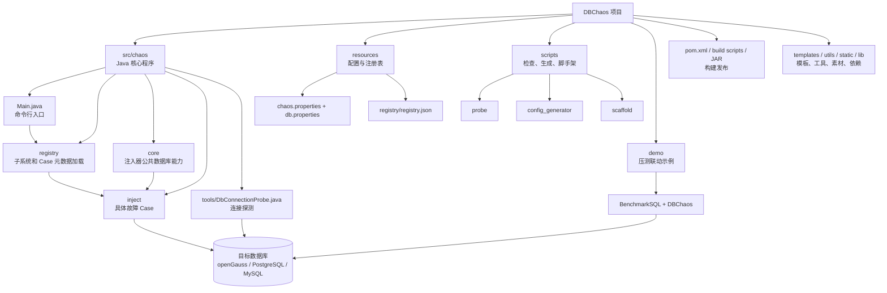
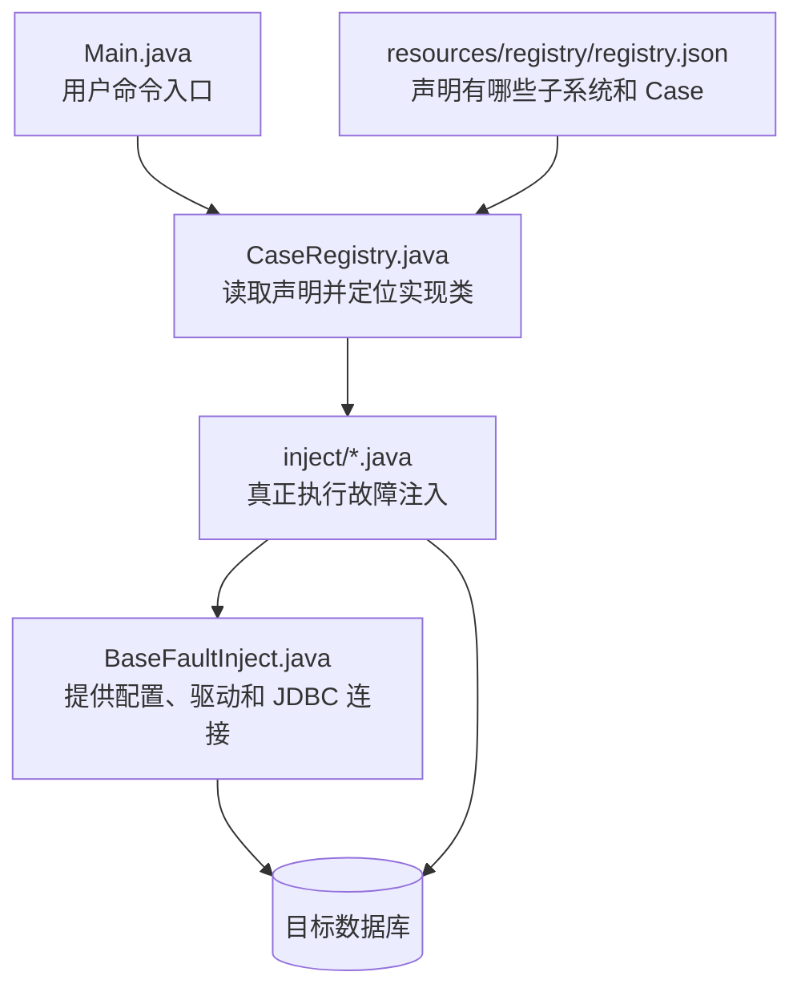

# DBChaos 架构说明

这份说明按“先认识文件，再理解关系”的顺序组织。仓库根目录是 `D:\Code\DBChaos\DBChaos`。

## 1. 项目由哪些部分组成



### 目录职责

| 目录 | 你需要先知道的事情 |
|---|---|
| `src/chaos` | 项目的 Java 核心运行时。CLI、注册表、数据库探测和注入器都在这里。 |
| `resources` | Java 程序运行时读取的配置和 Case 注册信息。 |
| `scripts` | 项目外围自动化：连接检查、配置生成、新 Case 脚手架。 |
| `demo` | 把 BenchmarkSQL 压测和 DBChaos 注入串起来的示例。 |
| `templates` | 新注入器的 Java 模板。 |
| `utils` | 配置迁移、TPC-C 曲线绘制等辅助程序。 |
| `static` | README 和 Demo 使用的图片。 |
| `lib` | 本地保存的 JDBC 依赖。 |

## 2. 文件树（文字版）

下面按实际目录层级展开；右侧说明各目录和重要文件的作用。`.git` 是版本管理内部目录，不展开其内部对象。`target` 是构建生成目录，其内容随构建变化。

```text
DBChaos/
├── .git/                              Git 版本历史与仓库元数据
├── .gitignore                         忽略构建产物及本地文件
├── README.md                          项目定位、快速开始与使用说明
├── pom.xml                            Maven 构建、Java 8 和 JDBC 依赖声明
├── build_for_linux.sh                 Linux 构建入口
├── build_for_win.ps1                  Windows 构建与帮助预览入口
├── DBChaos-0.0.1.jar                   仓库中已有的可执行 JAR
├── src/                               Java 源码
│   └── chaos/
│       ├── Main.java                  命令行入口、参数检查、Case 调度
│       ├── core/                      注入器共享基础能力
│       │   └── BaseFaultInject.java   配置加载、驱动选择、JDBC 连接和参数工具
│       ├── inject/                    具体故障注入实现
│       │   ├── MaxConnectionInject.java    连接风暴、连接耗尽、执行线程饱和
│       │   ├── PlanFlipInject.java         数据倾斜与统计信息变化导致的计划扰动
│       │   ├── StackOverflowInject.java    深层 SQL、嵌套视图、Join 和递归压力
│       │   ├── UncommittedTxnInject.java   未提交长事务持锁
│       │   ├── DuplicateTxnInject.java     热点更新与重复插入冲突
│       │   ├── DeadlockStormInject.java    交叉加锁与死锁检测压力
│       │   ├── MaxPreparedInject.java      Prepared/XA 事务积压
│       │   ├── MvccBloatInject.java        长快照与反复更新制造版本膨胀
│       │   ├── ReadAmpTrapInject.java      版本膨胀后的扫描与读取放大压力
│       │   ├── MemoryPressureFault.java   大对象写入压力
│       │   ├── MassiveRollbackInject.java 高频事务回滚压力
│       │   └── TestCaseInject.java         示例 Case 实现
│       ├── registry/                  Case 注册与查找
│       │   ├── CaseRegistry.java      读取注册表、查找 Case、反射创建注入器
│       │   ├── CaseDescriptor.java    单个 Case 的元数据模型
│       │   ├── SubsystemDescriptor.java 子系统的元数据模型
│       │   └── SimpleJsonParser.java  内置轻量 JSON 解析器
│       └── tools/                     独立运行的小工具
│           └── DbConnectionProbe.java JDBC 连接和 SELECT 1 探测
├── resources/                         打包进 Java classpath 的配置
│   ├── chaos.properties               CLI 名称、版本、横幅和描述
│   ├── db.properties                  默认数据库类型与连接参数
│   └── registry/
│       └── registry.json              子系统、Case 实现类及配置生成 profile
├── scripts/                           自动化辅助脚本
│   ├── README.md                      脚本入口说明
│   ├── probe/                         连接与环境预检查
│   │   ├── check_db_connection.ps1     Windows 连接探测包装脚本
│   │   ├── check_db_connection.sh      Linux/macOS 连接探测包装脚本
│   │   └── preflight_check.sh          注入及 Demo 环境检查
│   ├── config_generator/              外部压测配置生成
│   │   ├── generate_configs.py        从注册表生成 TPC-C/ChaosBlade XML
│   │   └── README.md                  参数、模板与输出说明
│   └── scaffold/                      新 Case 开发脚手架
│       ├── new_case.py                生成 Java 类并追加注册元数据
│       ├── new_case.ps1               Windows 包装入口
│       ├── new_case.sh                Linux/macOS 包装入口
│       └── README.md                  新 Case 创建说明
├── demo/                              压测与故障注入联动示例
│   ├── demo.sh                        预检、启动压测、延迟注入和生成报告
│   ├── opengauss.properties           BenchmarkSQL 压测配置
│   └── README.md                      Demo 环境及操作说明
├── templates/                         代码生成模板
│   └── CaseInject.java.template       新注入器的 Java 骨架
├── lib/                               本地第三方依赖 JAR
│   ├── opengauss-jdbc-7.0.0-RC2.jar    openGauss JDBC 驱动
│   ├── postgresql-42.7.2.jar           PostgreSQL JDBC 驱动
│   ├── mysql-connector-j-8.0.33.jar    MySQL JDBC 驱动
│   ├── checker-qual-3.42.0.jar         类型检查注解依赖
│   └── protobuf-java-3.21.9.jar        Protocol Buffers Java 依赖
├── static/                            文档展示素材
│   ├── licensed-image.jpg             README 图片
│   └── demo/                          连接类故障演示图
│       ├── conn_storm.svg             连接风暴演示
│       ├── conn_exhaustion.svg        连接耗尽演示
│       └── thread_saturation.svg      线程饱和演示
├── utils/                             辅助迁移与结果分析工具
│   ├── convert_cases.py               旧版 XML 故障配置转换工具
│   ├── plot_tpcc_tpm.py               从 BenchBase 结果绘制 TPM 曲线
│   └── readme                         空的说明占位文件
├── target/                            Maven 自动生成的构建产物
│   ├── classes/                       编译后的类和复制后的资源
│   ├── generated-sources/             构建生成的源码目录
│   └── maven-status/                  Maven 编译状态记录
└── yxf_files/                         本次项目交接说明
    ├── DBChaos_架构说明.md             架构图、文字文件树及源码定位
    └── README.md                      交付文件索引
```

具体源码的可点击行号引用见第 4 节。

## 3. 先看懂核心文件之间的关系

下图只表达“谁依赖谁”，不把具体执行步骤提前塞进目录介绍中。



## 4. 代码定位引用

下面只引用少量关键行，帮助你从架构图跳到源码。点击链接即可打开对应行。

- Java 程序入口：[`Main.main`](D:\Code\DBChaos\DBChaos\src\chaos\Main.java:56)
- `Main` 创建注入器：[`REGISTRY.createInjector(...)`](D:\Code\DBChaos\DBChaos\src\chaos\Main.java:128)
- 命令参数解析：[`parseCommandContext`](D:\Code\DBChaos\DBChaos\src\chaos\Main.java:297)
- 注册表资源路径：[`/registry/registry.json`](D:\Code\DBChaos\DBChaos\src\chaos\registry\CaseRegistry.java:18)
- 注册表通过反射加载实现类：[`Class.forName(...)`](D:\Code\DBChaos\DBChaos\src\chaos\registry\CaseRegistry.java:97)
- 注册表中声明实现类的例子：[`MaxConnectionInject`](D:\Code\DBChaos\DBChaos\resources\registry\registry.json:46)
- 注入器继承的 JDBC 连接入口：[`getConnection`](D:\Code\DBChaos\DBChaos\src\chaos\core\BaseFaultInject.java:139)
- 注入器基类构造和配置加载：[`BaseFaultInject(...)`](D:\Code\DBChaos\DBChaos\src\chaos\core\BaseFaultInject.java:163)
- 连接探测的实际 SQL：[`SELECT 1`](D:\Code\DBChaos\DBChaos\src\chaos\tools\DbConnectionProbe.java:32)
- Demo 把命令参数传给 JAR：[`java -jar ... $FAULT_PARAMS`](D:\Code\DBChaos\DBChaos\demo\demo.sh:112)

## 5. 你接手项目时建议的阅读顺序

1. 先读本文件第 1、2 节，建立目录和模块地图。
2. 再读 [`Main.java`](D:\Code\DBChaos\DBChaos\src\chaos\Main.java:56)，了解 CLI 入口。
3. 读 [`registry.json`](D:\Code\DBChaos\DBChaos\resources\registry\registry.json:1)，了解 Case 清单和元数据。
4. 读 [`CaseRegistry.java`](D:\Code\DBChaos\DBChaos\src\chaos\registry\CaseRegistry.java:90)，了解元数据如何找到 Java 类。
5. 读 [`BaseFaultInject.java`](D:\Code\DBChaos\DBChaos\src\chaos\core\BaseFaultInject.java:1)，了解所有注入器共享的数据库能力。
6. 最后按感兴趣的数据库内核子系统阅读 `src/chaos/inject` 下的具体实现。
